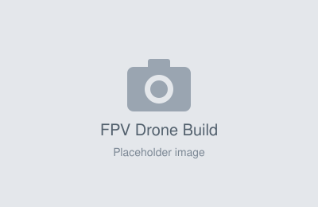

> **Test entry.** This post is placeholder content to preview the blog layout. Replace it with your own writing.

This post walks through building and programming a custom FPV drone: choosing parts, setting up an ELRS radio controller, and capturing my first aerial footage.

Notes for a future version of this post:

* Parts list and why I picked each one.
* Flashing and configuring the flight controller.
* Reading telemetry and what it says about flight performance.
