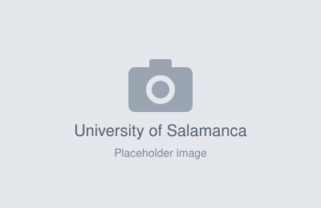

Published work on the importance of utilizing advanced tools like Python and SQL in academic research, presented at the X International Conference in Statistics and Operational Research in Salamanca, Spain.

