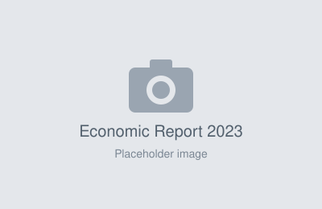

Calculated the Human Development Index (HDI) for Puerto Rico for 2012–2023 and contributed a chapter to the *Economic Report for the Governor 2023*, using data from IPUMS and other government sources.

The code is available at [github.com/ouslan/IDH-index](https://github.com/ouslan/IDH-index).

